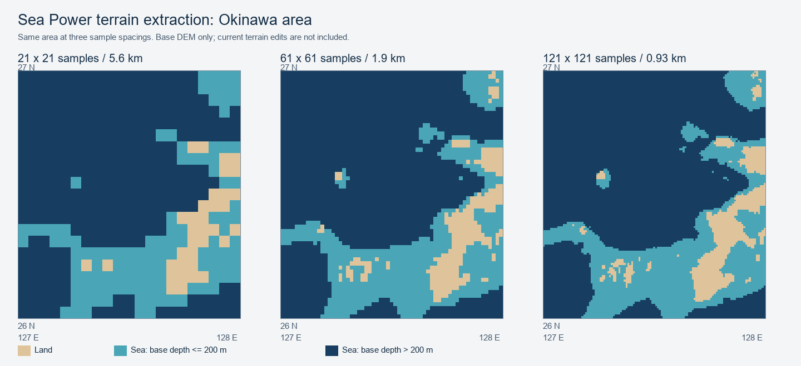

# 地形情報の取得とAIへの提供に関する調査

調査日：2026年10月26日（JST）。対象はSea Power AI Advisorの`f163dd2`時点の実装と、同日にローカルで確認したゲーム本体・地形ファイル。

**ゲームの地表・海底の高さを地域単位で取得し、AI向けの数値や分類データへ変換するための材料と取得経路は存在する。** 単一点の可否確認に限定せず、周辺の陸地・浅海・深海の分布をまとめて提供できる可能性を確認した。

ただし、基礎データを抽出できることと、ゲーム内の地形・水深に一致すること、AIの助言が改善することは別の検証対象である。現段階では製品への組み込みや送信形式を確定していない。

地形データの取得・提供とは別に、モデルの既存の現実地理知識を計画へ活用させる指示を採用した。地形の取得機能を追加したものではなく、座標精度の改善も保証しない。文案と比較結果は[プロンプト見直しの記録](prompt-review.md)を参照する。

## 調査の目的と範囲

AIが地形を踏まえて移動経路、哨戒範囲、ソノブイの配置などを考えられるようにする。指定座標を一つずつ検査するだけでは、AIが周辺の形状を把握する材料が不足し、照会の往復も増えやすい。そのため、地域の取得方法、実効的な細かさ、取得コスト、送信量を調べた。

今回の確認方法はゲームDLLの読み取り専用の静的解析と、実際の地形ファイルを使ったオフライン抽出である。ゲームは起動しておらず、実AI通信も行っていない。静的に見つけたゲーム側の関数を、実行中のゲームで呼び出せたことを示す結果ではない。

関連資料：

- [ユニット操作の設計](ai-unit-control-design.md)
- [AIプロバイダーと相談実行方式の設計](ai-provider-design.md)
- [公開APIガイド](public-api.md)

## 結論と確認状況

| 項目 | 確認状況 | 判断できること |
| --- | --- | --- |
| 単一点の地形取得 | ゲーム内の取得処理を静的に確認 | 高さを取得する経路が存在する |
| 地域の地形取得 | 経路探索用の配列生成処理を静的に確認 | 地域単位の取得を検討できる |
| 実ファイルからの地域抽出 | 沖縄周辺で実施 | 陸地と海底の高さを数値・分類データへ加工できる |
| 容量と粒度の比較 | 同じ地域で実施 | 表現方法によるJSONのバイト数の違いを比較できる |
| 実ゲームの表示・水深との一致 | 未検証 | 地形改変を含む一致は保証できない |
| 実ゲーム内での取得負荷 | 未検証 | フレーム時間・GC・キャッシュ待ちの影響は判断できない |
| AIの理解と助言への効果 | 未検証 | 読解精度・計画改善・必要な説明量は判断できない |
| 実モデルの入力トークン数 | 未測定 | バイト数からトークン数を確定できない |

## 予約と地形判定に関する観測

ユーザーは、船の移動予約とソノブイの投下予約を陸上に対しても登録できることを実プレイで確認している。この操作は今回の調査では再現していない。

予約を受理することだけでは、予約時に何も検査していないのか、実行時に地形へ対応するのか、どの衝突判定を使うのかは判断できない。静的解析では次を確認した。

- `Vessel.OnCollisionEnter`と`OnCollisionExit`には、名前に`Terrain`を含む物体との接触フラグを設定・解除する処理がある。
- `Bomb.OnFixedUpdate`には高さと水面相当の値を比較する経路、`WeaponBase.CheckCollision`の呼び出し、`DeploySonobuoy`への分岐がある。
- 潜水艦の座礁リスク判定やソナー計算などは、数値の地形高を取得する`TerrainUtils.GetHeightAt`も参照している。

したがって、衝突判定を使う処理は存在するが、地形の取り扱い全体が3Dオブジェクトの衝突だけに依存している構造ではない。陸上で投下したソノブイが実際にどう扱われるかという全体の動作は、別途実機で確認する必要がある。

地形情報をAIへ提供する可否は、予約の受理条件や投下後の有効性の解明とは分けて検討できる。

## ゲーム内の取得経路

以下はゲームDLL上の処理であり、AI Advisorの公開SDKへ追加済みのAPIではない。ゲーム更新後も同じ契約で使えるという保証もない。

| 処理 | 主な内容 | 利用時の注意 |
| --- | --- | --- |
| `TerrainUtils.GetRealHeightInMetersAt(GeoPosition, bool)` | 地形高を取得しメートルへ変換する | 地形無効時の特殊な戻り値を持つ |
| `TerrainUtils.GetHeightAt(GeoPosition, bool, bool)` | ロード済みの地形チャンクを優先し、なければキャッシュ済みDEMを読む | 戻り値はUnity側の高さ単位。共有ロックと欠損時の経路がある |
| `TerrainUtils.GetDEMHeightAt(GeoPosition)` | キャッシュ済みDEMを直接読む | 地形チャンクの改変後の値と同一とは限らず、高さ・水深係数の影響もある |
| `TerrainLoader.loadHeightMapForPathFinder(string, GeoPosition, ref short[], int)` | 中心座標と配列サイズから経路探索用の地域配列を作る | ゲームDLL上でpublicなインスタンスメソッド。生の地域配列であり、完成したAI向け地図ではない |
| `TerrainLoader.TryGetCached` / `GetOrLoad` | DEMキャッシュの参照や必要なデータの読み込みを行う | `DEMHandle`の解放、キャッシュとUnityリソースの寿命、ロード待ちを考慮する必要がある |

地域配列の取得処理は`mapSize * mapSize`の`short`配列を用意し、`loadDataForPathFinder`を通してDEMを読み込む。単一点の関数を独自に大量呼び出しする以外にも、既存の地域取得経路を利用できる余地がある。

一方、`GetHeightAt`はキャッシュ済みのデータを参照する経路であり、その関数を呼ぶだけで未ロード地域が必ず読み込まれるわけではない。地域配列の生成側には`GetOrLoad`を使う経路があるため、取得方法によってロード待ちや副作用としてのキャッシュ確保が異なる。

`Utils.unityHeightToMeter`はUnity側の高さを`0.01488094`で割ってメートルへ変換する。この変換はゲーム関数の戻り値の単位を確認して適用するものであり、メートルとして抽出した基礎DEMへ重ねて適用しない。

### 未取得と水深を区別する必要

`GetHeightAt`には、地形が無効な場合や、利用できるチャンク・DEMがない場合に`-10000`を返す経路がある。`GetRealHeightInMetersAt`も地形無効時には直接`-10000`を返す一方、通常経路では取得したUnity側の値をメートルへ変換する。

このため、関数名や返された負値だけを根拠に「深い海」と判断してはいけない。実装時には地形の有効状態、初期化、対象地域のデータの可用性と単位を確認し、未取得を明示できる形にする。特定の数値を一律に欠損扱いする方法も、実際の深海の値と衝突し得る。

## 基礎データの構成と解像度

DEMは標高を格子状に保持するデータで、今回確認したものは地表と海底の高さを符号付き整数で扱う。地形ファイルは`Sea Power_Data/StreamingAssets/original/terrain/data/`に存在した。

| データ | 確認した構成 | 用途と制約 |
| --- | --- | --- |
| 基礎DEM | 20度四方につき2400×2400点、16bit符号付き整数、全162タイル | 地表・海底の基礎データ。1タイルの展開後サイズは11,520,000バイト |
| 基礎DEMの間隔 | 30秒角、約0.008333度 | 南北方向で約926m。東西方向の距離は緯度に依存する |
| `lowres.raw` | 7200×3600点、51,840,000バイト | 全域用の低解像度表示データ。3分角相当で、細部の確認には粗い |

基礎DEM全体の展開後サイズは計算上約1.87GBになる。地域を絞って扱う構成なら、全域をAIへ送ったり、常時すべて展開したりする必要はない。

今回のタイル抽出では、LZ4ファイル末尾の4バイトをリトルエンディアンの展開後サイズとして読み、その手前の圧縮ブロックを復号した。復号結果が11,520,000バイトであることを確認し、リトルエンディアンの符号付き16bit値として参照した。これは調査用の読み取り手順であり、製品側の取得契約ではない。

「約926m」は元データの格子間隔であり、海岸線の位置精度を926m以内と保証する値ではない。また、ゲーム側の補間によって値を細かく取得できても、元データにない細い水路や小島の詳細が増えるわけではない。

### 座標変換

ゲームの`Utils.longLatToDEMChunk`と`longLatToInDEMChunkPosition`には、タイルの選択・境界処理・座標オフセットがある。今回の抽出は、その変換式に沿って行った。

特にタイル内位置の算出には、緯度側の`0.00833333376795053`度、経度側の`0.0250000013038516`度のオフセットが現れる。実装時に単純な世界地図の添字計算へ置き換えると、ゲームと異なる位置を参照する可能性がある。この調査で全世界の境界・極域・日付変更線まで検証したわけではないため、既存の変換経路を優先して確認する。

## 基礎DEMとゲーム内の地形の違い

`TerrainLoader.loadHeightMap`には補間や平滑化に関連する処理があり、地形設定にはノイズや高さ・水深の調整もある。さらに`checkForAndApplyStamp`は、ミッションのデータディレクトリやワールド側の`chunk_*.dat` / `chunkSplat_*.dat`を調べ、地形や地表情報の改変を適用する。

`GetHeightAt`がロード済みの`TerrainChunk`を優先する点も重要である。基礎DEMだけを読む経路と、改変後のチャンクを読む経路は、同じ座標でも同一の値になるとは限らない。

AIへ渡す際は少なくとも、どの取得元の値か、元の間隔と提供する格子の間隔、改変をどの範囲まで反映しているか、取得できない部分があるかを区別する必要がある。実行中のゲームの値を取得したという理由だけで、地域全体の精度や取得条件が均一だと扱わない。

元データを直接読む調査用スクリプトを、そのまま製品側の別実装として持ち込むことは推奨しない。既存の取得経路と有効なワールドパスを使う構成を優先し、ミッションや追加MODによる地形改変との整合性を確認する。

## 沖縄周辺の地域抽出

`y4x16.lz4`から、緯度26〜27度、経度127〜128度の範囲を抽出した。南北約60nm、東西距離はこの緯度では南北より短い。同じ範囲について点数と表現を変え、compact JSONのUTF-8バイト数を比較した。

比較用格子の原点は北緯27度・東経127度、行は北から南、列は西から東である。各軸は両端を含み、`n`点の間隔を`1 / (n - 1)`度とした。

今回の分類は次の試験用の定義であり、ゲームや製品の正式な「浅海」「深海」の定義ではない。基礎値の単位は、ゲーム側の高さ・水深調整を適用する前のメートルとした。

| 記号 | 試験用の意味 |
| --- | --- |
| `L` | 基礎標高が0mより高い |
| `Z` | 基礎標高が0mで、海岸としての扱いが曖昧 |
| `S` | 基礎標高が-200〜-1m |
| `D` | 基礎標高が-200m未満 |

比較した表現は、各点へ緯度・経度・高さを繰り返し記載する一覧、原点・軸方向・間隔を共通化した数値格子、分類記号を行ごとに並べた格子、同じ分類の連続を記号と個数の組へまとめるRLEの4種類である。

| 点数 | 南北の間隔 | 座標付きの点一覧 | 高さの数値格子 | 分類格子 | 分類格子のRLE |
| --- | ---: | ---: | ---: | ---: | ---: |
| 21×21 | 5,556m | 8,337 | 2,353 | 839 | 1,045 |
| 31×31 | 3,704m | 23,367 | 4,869 | 1,395 | 1,571 |
| 61×61 | 1,852m | 91,910 | 18,172 | 4,245 | 3,158 |
| 121×121 | 926m | 369,532 | 70,674 | 15,345 | 6,498 |

容量の列はすべてバイト。表は元の測定値を保持しており、分類格子には凡例などのメタデータも含む。**これらは入力トークン数の測定結果ではない。** 同じデータを短い記号やRLEへ変えても、AIの読解やトークン数が同じ比率で改善するとは限らない。小さい格子ではRLEの方が大きくなった例もある。

現行の通常の情報応答上限は48,000バイト、相談全体の情報予算は160,000バイトである。121×121の数値格子は単体でも通常応答の上限を超えるが、同じ領域の分類格子は上限内に収まる。他の情報と一緒に返す場合の予算や、履歴を再送する接続での後続要求の負担も別に考慮する。

図は抽出結果を人間向けに可視化したもので、実ゲームのスクリーンショットでもAIへ送信した画像でもない。青は`D`、水色は`S`、茶色は`L`。現在のミッションやワールドの地形改変は適用していない。

### 元データより細かく標本化した場合

0.1度四方を121×121点、約92.6m間隔で抽出すると、14,641点が169個の元セルへ重複した。数値の個数を増やしても、この方法では細部の地形情報は増えない。

細かい間隔の指定を許すことと、精度の高い情報を返せることを区別する。細かい格子を返す場合にも、元データの間隔と補間の有無を示す必要がある。

## 粗い格子で小島を消さないための集計

図のような代表点の間引きでは、小さな陸地が標本点の間へ入り、粗い格子から消える場合がある。粗いセルの代表点が海だったことを、そのセル全体が海だという情報へ広げてはいけない。

比較用に、121×121の元の標本を21×21セルへ集計し、陸と海・海岸を含むセルを`C`として残す処理も確認した。元の標本をすべて集計対象とし、各セルの最小・最大標高も保持した。

| 集計結果 | 値 |
| --- | ---: |
| 集計後のセル数 | 21×21 |
| 海陸混在として残ったセル | 81 |
| 分類だけのJSON | 935バイト |
| 分類と最小・最大標高を含むJSON | 6,133バイト |

この方法は、集計対象の標本に含まれる陸地の存在を失わないための例である。小島の正確な形状や、元データで表現されていない地形を復元するものではない。混在セルがあることから、そのセル全体を航行不能と結論付けることもできない。

分類記号、深度の区切り、セルの集計方法、AIへ渡す説明は、今後の検証で選ぶ。容量を減らすことだけを目的に、モデルが理解しづらい圧縮表現を採用しない。

## 取得コストの参考値

WSLのPythonから`liblz4`を使った調査用スクリプトでは、1タイルの読み込みと復号を約62.4msで処理した。対象ファイルは9,050,340バイト、展開後は11,520,000バイトだった。

同じスクリプト内の点抽出・比較用データの構築は、61×61点で約10.5ms、121×121点で約43.1msだった。いずれも単回の参考値で、ゲームAPIの呼び出し、大量取得時のフレーム時間、GC、ロード待ちを測ったものではない。

実装では、毎回のファイル読み込み・復号を前提にせず、既存キャッシュと取得元の寿命を確認する。共有ロックがある関数を大量に呼び出す負担や、未ロードのタイルを同期的に待つ処理については、別途ゲーム内で確認する必要がある。

## 実装を検討する際の責務と未決定事項

以下は調査結果に基づく構成案であり、実装済みの仕様ではない。

| 担当 | 責務 |
| --- | --- |
| ゲーム連携の共通部品 | 地形の取得、値のコピー、座標変換、取得元・単位・粒度・可用性の管理 |
| 戦況情報の読み取り基盤 | 必要な海域の要求受付、応答の予算管理、AIへ渡す地域データの構成 |
| 各コマンド | 地形をどう適用するか、操作としての条件・妥当性をどう扱うか |
| AI | 地域の地形と戦況を踏まえた経路・配置・作戦計画の判断 |

地形取得を特定のソノブイコマンドへ閉じ込めず、通常の助言や将来の移動・対潜コマンドも共通の取得処理を利用できる構成が自然である。一方、共通部品が作戦上の最適経路を選んだり、コマンド固有の可否を判断したりする必要はない。

提供形式の候補は、地域の地形をまとめた情報と、必要地点・区間の追加照会である。最初から全世界の格子を送る方式、陸上予約の一律拒否、経路の自動修正を前提にしない。地形情報を助言・計画へ使う機能と、ゲーム操作を制限・補正する機能は別に判断する。

実装前に決める必要がある項目は次のとおり。

- 基礎DEMと改変後の地形のどちらを、どの用途・範囲で使うか。
- 対象範囲、粒度、最大応答サイズ、混在・欠損の表現。
- 相談開始時の固定情報との関係と、照会中のキャッシュ・地形状態の変化の扱い。
- 通常の情報選択や3種類の戦況送信方式と、地域照会をどう組み合わせるか。
- 生の数値格子、分類格子、集計、簡略海岸線など、モデルが理解できる形式の選定。

## 次に必要な検証

1. **実ゲームとの照合**：外洋、海岸、小島、港湾・狭い水路、地形改変のある場所について、取得値と表示・水深を比較する。キャッシュ済みと未ロード、地形無効の条件も分ける。
2. **取得負荷と寿命の確認**：少量から地域単位へ増やし、フレーム時間、GC、メモリ、ロード待ち、ミッション切り替え時の失効を確認する。
3. **AIの読解と有用性の比較**：同じ戦況・同じ質問で、地形なしと候補形式を比較する。海陸や水深の取り違え、ユーザー意図、経路・配置の妥当性、往復回数、待ち時間を評価する。
4. **実トークン数の計測**：リクエスト本文のサイズとプロバイダーのusageを記録し、容量削減がトークン削減につながるか確認する。

## 根拠と再確認の手掛かり

ゲーム本体や元の地形ファイル、逆アセンブル結果は配布物へ含めない。以下の識別情報と測定表は、ローカルの調査成果物がない環境でも確認対象と結論の範囲を追えるように記載する。

| 対象 | 識別情報 |
| --- | --- |
| ゲームDLL | `Sea Power_Data/Managed/Seapower-Scripts.dll` |
| DLLサイズ | 8,528,384バイト |
| DLL SHA-256 | `eab2297ba92c6013958bdb2cf16d5794a4731330818ce353f89dc2241e16a3bd` |
| 抽出したタイル | `original/terrain/data/y4x16.lz4` |
| タイル SHA-256 | `7c4edce98adc9b11d77854d94d71f82f7ea0f976e365c060d5437db6c37e8525` |
| 元の抽出範囲 | 緯度26〜27度、経度127〜128度 |
| 既存の応答予算 | `src/Advisor/Consultation/IAdvisorQuerySession.cs`の`AdvisorQueryLimits` |

ローカル専用の証跡は`artifacts/terrain-research-20261026/`に保存した。このディレクトリはGit管理・通常配布の対象外である。

| 証跡 | 内容 |
| --- | --- |
| `findings.json` | 調査結果、判断、未検証事項、DLL識別情報 |
| `discovery.txt` | 地形関連の型・フィールド・メソッドの一覧 |
| `height-details.txt` | 高さ取得処理と、その呼び出し元のIL |
| `utils-details.txt` | 座標変換、単位変換、低解像度データの読み込み、復号経路 |
| `bulk-reader.txt` | 地域配列の取得と地形改変ファイルの参照処理 |
| `physics-details.txt` | 船の地形衝突とソノブイ関連処理 |
| `regional-extraction.json` | 原データ情報と容量・粒度の比較結果 |
| `conservative-regional-summary.json` | 海陸混在と標高範囲を残す集計結果 |
| `extract-region.py` / `render-preview.py` | 抽出と人間向けの可視化に使った調査用スクリプト |

容量の再計測では、分類の閾値、メタデータ、原点と軸方向、標本点の位置、JSONの空白・改行の扱いを同じ条件にする。元の容量計測はcompact JSON本体のバイト数で、保存ファイル末尾の改行は数えていない。図は分類格子の比較用の派生資料として本書に保存したものであり、製品が画像をAIへ送信する実装を追加したことを意味しない。
